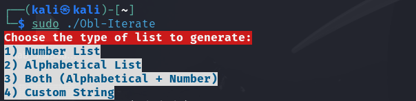
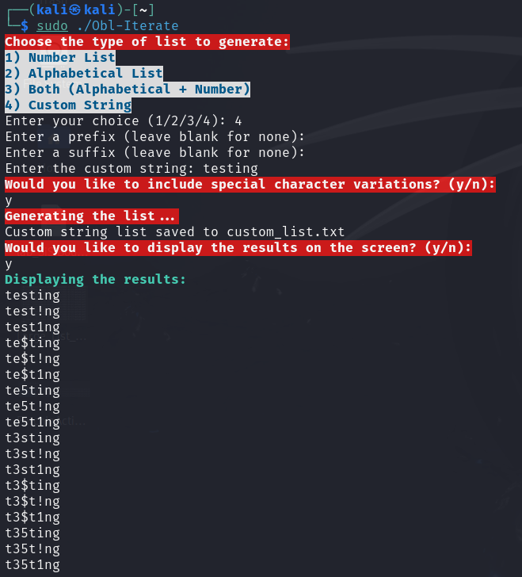

```
  ____                        ___     __  __       _          ___ _   
 / ___|___  _ __ ___   ___   ( _ )   |  \/  | __ _| | _____  |_ _| |_ 
| |   / _ \| '_ ` _ \ / _ \  / _ \/\ | |\/| |/ _` | |/ / _ \  | || __|
| |__| (_) | | | | | |  __/ | (_>  < | |  | | (_| |   <  __/  | || |_ 
 \____\___/|_| |_| |_|\___|  \___/\/ |_|  |_|\__,_|_|\_\___| |___|\__|
 
 				⠀⢀⣀⣠⣤⣴⣶⣶⣶⣦⣄⡀⠀⠀⠀⠀⠀⠀⠀⠀⠀⠀⠀⠀⠀⠀⠀⠀
⠀⠀⠀⠀⠀⠀⠀⠀⠀⠀⠀⠀⠀⠀⠀⠀⠀⠀⠀⠀⠀⣀⣤⡴⠞⠛⣋⣭⣤⣤⣄⡀⠀⠀⢸⣿⣄⠀⠀⠀⠀⠀⠀⠀⠀⠀⠀⠀⠀⠀⠀⠀
⠀⠀⠀⠀⠀⠀⠀⠀⠀⠀⠀⠀⠀⣀⣀⣀⡀⠀⣠⡴⠾⠋⠁⠀⠐⠛⠋⠉⠛⣿⣿⡇⠀⠀⢸⡏⢻⡆⠀⠀⠀⠀⠀⠀⠀⠀⠀⠀⠀⠀⠀⠀
⠀⠀⠀⠀⠀⠀⠀⠀⢀⣤⣴⠶⠟⠛⠛⠛⠛⠛⠿⠷⢤⣄⣀⠀⠀⠀⠀⠀⢠⣿⡿⠀⠀⠀⢸⣷⠀⣿⠀⠀⠀⠀⠀⠀⠀⠀⣀⣄⡀⠀⠀⠀
⠀⠀⠀⠀⠀⠀⢀⣶⠟⠉⠀⠀⠀⠀⠀⠀⠀⠀⠀⠀⠀⠈⠉⠛⠳⢦⣤⣀⠼⠋⠀⠀⠀⠀⠀⢻⣷⣹⡇⠀⠀⠀⠀⠀⢀⣾⣿⣿⢻⡆⠀⠀
⠀⠀⠀⠀⠀⣠⡿⠁⠀⠀⠀⠀⠀⠀⠀⠀⠀⠀⠀⠀⠀⠀⠀⠀⠀⠀⠈⠙⠳⢦⣄⣀⡀⠀⠀⠀⢹⣿⣧⠀⠀⠀⣀⣴⡿⢿⣿⣿⡇⢹⡄⠀
⠀⠀⠀⠀⢠⡿⠀⠀⠀⠀⠀⠀⠀⠀⠀⠀⠀⠀⠀⠀⠀⠀⠀⠀⠀⠀⠀⠀⠀⠀⠈⠉⠙⡻⠷⠶⠶⠿⠿⠶⠶⢟⠋⣉⣺⣿⣿⣿⡇⢸⡇⠀
⠀⠀⠀⠀⢸⡇⠀⠀⠀⠀⠀⠀⠀⠀⠀⠀⠀⠀⠀⠀⠀⠀⣀⣠⣤⣤⣤⣤⣤⣴⣶⣾⣾⣦⣤⣤⣄⣀⠀⠀⢠⣾⣿⣿⣿⣿⣿⣿⡇⢸⠇⠀
⠀⠀⠀⠀⢸⣧⠀⠀⠀⠀⠀⠀⠀⠀⠀⠀⠀⠀⣠⣴⡾⠟⠛⠉⠀⣀⣀⠀⠀⠈⠙⠻⠿⣿⣿⣿⣿⣿⣿⣿⣶⣿⣿⣿⣿⣿⣿⣿⢣⡟⠀⠀
⠀⠀⠀⠀⠘⣿⡀⠀⠀⠀⠀⠀⠀⠀⠀⠀⣠⣾⢫⣿⡟⠀⠀⠀⣪⣿⣍⡙⠲⠄⠀⣤⠠⣄⣸⡿⠻⣿⡇⢻⣿⣿⣿⣿⣿⣿⣿⢋⡾⠁⠀⠀
⠀⠀⠀⠀⠀⠹⣿⡀⠀⠀⠀⠀⠀⠀⠀⢠⣿⣿⣾⣿⡇⠀⠠⠞⢹⣩⣽⣿⣷⣾⣿⡇⢀⣿⣦⣶⡟⠛⣿⣾⣿⣿⣿⣿⣿⡿⣡⡞⠁⠀⠀⠀
⠀⠀⠀⠀⠀⠀⠙⢷⣄⠀⠀⠀⠀⠀⢠⣾⣧⣝⣿⣿⡇⠀⠀⠐⠛⣿⣿⣿⣿⡏⢻⠀⠘⣿⡟⢿⣯⡿⣿⣏⣿⣿⣿⡿⣫⡾⠋⠀⠀⠀⠀⠀
⠀⠀⠀⠀⠀⠀⠀⠀⠹⢷⣄⡀⠀⠀⢸⡇⣏⣼⡟⠞⡃⠀⠀⠀⠀⠀⠀⠀⠉⠁⠀⠀⠀⣿⡇⠀⠀⠀⢸⡏⣿⣿⣽⠞⠉⠀⠀⠀⠀⠀⠀⠀
⠀⠀⠀⠀⠀⠀⠀⠀⠀⠀⠉⠻⠶⣤⣄⣿⠀⠻⣅⠀⣷⠀⠀⠀⠀⠀⠀⠀⢀⣄⠀⠀⠀⢹⢿⣦⠀⠀⣸⣧⡟⠉⠀⠀⠀⠀⠀⠀⠀⠀⠀⠀
⠀⠀⠀⠀⠀⠀⠀⠀⠀⠀⠀⠀⠀⠀⠀⠙⢷⣄⠉⠀⠹⡄⠀⠀⠀⠀⠀⠀⠸⠿⠛⢳⣤⣾⣿⣿⣷⣾⣿⡏⠀⠀⠀⠀⠀⠀⠀⠀⠀⠀⠀⠀
⠀⠀⠀⠀⠀⠀⠀⠀⠀⠀⠀⠀⠀⠀⠀⠀⠀⠹⣾⡇⠀⠀⠀⡸⠁⠀⠀⠀⠀⠀⠀⢰⡝⠻⢿⣿⢿⣿⡟⠁⠀⠀⠀⠀⠀⠀⠀⠀⠀⠀⠀⠀
⠀⠀⠀⠀⠀⠀⠀⠀⠀⠀⠀⠀⠀⠀⠀⠀⠀⠀⡟⣇⠀⠀⢰⡇⠀⢠⡶⠶⠶⠖⠒⠿⠷⠶⢾⠿⠀⣿⡇⠀⠀⠀⠀⠀⠀⠀⠀⠀⠀⠀⠀⠀
⠀⠀⠀⠀⠀⠀⠀⠀⠀⠀⠀⠀⠀⠀⠀⠀⠀⠀⡇⢸⡄⠀⠈⣧⠀⠀⠀⠀⠐⢻⣷⣶⣶⣶⣿⣦⣾⣿⠃⠀⠀⠀⠀⠀⠀⠀⠀⠀⠀⠀⠀⠀
⠀⠀⠀⠀⠀⠀⠀⠀⠀⠀⠀⠀⠀⠀⠀⠀⢀⣤⡇⠈⢳⣀⠀⠘⣇⠀⠀⠀⠀⠈⠁⠀⠀⠀⠈⢻⣿⡏⠀⠀⠀⠀⠀⠀⠀⠀⠀⠀⠀⠀⠀⠀
⠀⠀⠀⠀⠀⠀⠀⠀⠀⠀⠀⠀⠀⠀⠀⣠⣿⣿⡇⠀⠀⠙⠷⢶⣬⣀⡀⠀⠀⠀⠀⠀⠀⠀⠀⣼⣿⠃⠀⠀⠀⠀⠀⠀⠀⠀⠀⠀⠀⠀⠀⠀
⠀⠀⠀⠀⠀⠀⠀⠀⠀⠀⠀⠀⠀⠀⣸⠇⢿⣟⠳⣄⠀⠀⠀⠀⠉⠛⢿⣿⣶⣤⣤⣤⣾⣦⣾⣿⣅⠀⠀⠀⠀⠀⠀⠀⠀⠀⠀⠀⠀⠀⠀⠀
⠀⠀⠀⠀⠀⠀⠀⠀⠀⠀⠀⠀⢀⣰⠟⠀⠈⢿⣄⠈⠛⠦⣄⣀⡀⠀⠀⠙⠿⠿⣿⣿⣿⣿⣟⣼⢿⣿⣦⠀⠀⠀⠀⠀⠀⠀⠀⠀⠀⠀⠀⠀
⠀⠀⠀⠀⠀⠀⠀⠀⠀⠀⣀⣴⡟⠁⠀⠀⠀⠀⠻⣷⣄⠀⠀⠉⠻⠿⣖⣒⡲⠲⠶⠿⢟⣻⣿⣧⠀⣷⣹⣷⡀⠀⠀⠀⠀⠀⠀⠀⠀⠀⠀⠀
⠀⠀⠀⢀⣠⣤⡶⠟⠛⠛⠋⢿⡇⠀⠀⠀⠀⠀⠀⠈⠙⢷⣤⣙⠦⢤⣄⣉⡉⠙⠛⣛⣯⣅⣸⡏⣧⢸⡇⢫⢳⣄⡀⠀⠀⠀⠀⠀⠀⠀⠀⠀
⢀⣤⠾⠛⠁⠀⠀⠀⠀⠀⠀⠘⣿⡄⠀⠀⠀⠀⠀⠀⠀⠀⠉⠛⢿⣿⠾⠾⢿⣿⣿⣿⣿⣿⣿⡇⣻⠸⣇⢸⡆⢿⡟⠳⠶⠦⠤⠤⣤⣤⣤⡄
⠋⠁⠀⠀⠀⠀⠀⠀⠀⠀⠀⠀⠈⢿⡄⠀⠀⠀⠀⠀⠀⣀⣤⣶⣾⡏⠳⣤⡀⠙⢿⡏⢹⡟⣻⠃⣿⢸⣿⢸⣷⠈⣿⣆⠀⠀⠀⠀⠀⠀⠀⠀
⠀⠀⠀⠀⠀⠀⠀⠀⠀⠀⠀⠀⠀⢸⣧⠀⠀⠀⠀⢠⣾⡿⠋⠀⣾⠁⠀⠀⠙⢦⡀⠁⠀⢱⡏⣰⠃⣼⣿⠀⣿⡀⠸⣏⣛⣦⠀⠀⠀⠀⠀⠀
⠀⠀⠀⠀⠀⠀⠀⠀⠀⠀⠀⠀⠀⠘⣿⠀⠀⣀⣼⣿⠏⠀⠀⠀⠙⠻⢦⣤⣀⣀⠻⣄⢠⡟⢀⡟⠀⣿⡇⠀⣿⡿⠾⠿⠉⠉⠁⠀⠀⠀⠀⠀
⠀⠀⠀⠀⠀⠀⠀⠀⠀⠀⠀⠀⠀⠀⠿⠶⠿⠛⠉⠀⠀⠀⠀⠀⠀⠀⠀⠀⠉⠉⠛⢿⣿⣥⣼⣇⠀⢹⡇⢀⣿⠃⠀⠀⠀⠀⠀⠀⠀⠀⠀⠀
⠀⠀⠀⠀⠀⠀⠀⠀⠀⠀⠀⠀⠀⠀⠀⠀⠀⠀⠀⠀⠀⠀⠀⠀⠀⠀⠀⠀⠀⠀⠀⠈⣿⠁⠀⢿⡄⠀⠉⢸⡟⠀⠀⠀⠀⠀⠀⠀⠀⠀⠀⠀
⠀⠀⠀⠀⠀⠀⠀⠀⠀⠀⠀⠀⠀⠀⠀⠀⠀⠀⠀⠀⠀⠀⠀⠀⠀⠀⠀⠀⠀⠀⠀⠀⢹⡇⠀⠀⠻⣆⠀⣼⠃⠀⠀⠀⠀⠀⠀⠀⠀⠀⠀⠀
⠀⠀⠀⠀⠀⠀⠀⠀⠀⠀⠀⠀⠀⠀⠀⠀⠀⠀⠀⠀⠀⠀⠀⠀⠀⠀⠀⠀⠀⠀⠀⠀⠀⠻⠄⠀⠀⠙⣿⡏⠀⠀⠀⠀⠀⠀⠀⠀⠀⠀⠀⠀
⠀⠀⠀⠀⠀⠀⠀⠀⠀⠀⠀⠀⠀⠀⠀⠀⠀⠀⠀⠀⠀⠀⠀⠀⠀⠀⠀⠀⠀⠀⠀⠀⠀⠀⠀⠀⠀⠀⠈⠀⠀⠀⠀⠀⠀⠀⠀⠀⠀⠀⠀⠀
```
* Interactive user functionality
* Form all possible combinations
* Special character substitutions
* Create Output File
* Use Input File
* Shoddy security hardening. If you break it, it is what it is. Just make the list Hoss.                                                                      

### Usage:

```
sudo ./Obl-Iterate
```

## STEP 2:
Choose your option from the prompt.



## STEP 3:
Follow the prompts.


